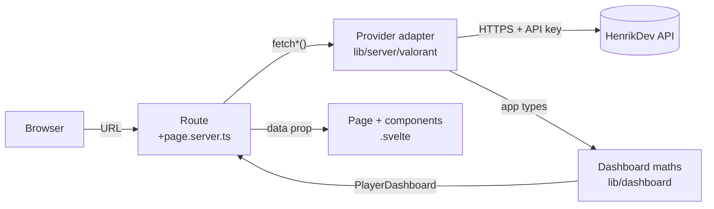

# Architecture

A guide for developers new to RNKUP: how the code is laid out, how a
request becomes a page, and where to make common changes. Terms such as
"Competitive History" and "KAST" are defined in [GLOSSARY.md](../GLOSSARY.md);
the reasons behind the bigger choices are in [docs/adr/](adr/).

## The mental model

The app has three layers. Data flows one way through them:



| Layer            | Folder                                          | Job                                  | Rule                                                               |
| ---------------- | ----------------------------------------------- | ------------------------------------ | ------------------------------------------------------------------ |
| Provider adapter | `src/lib/server/valorant/`                      | Fetch, validate, cache               | Only place that sees HenrikDev JSON or the API key                 |
| Domain logic     | `src/lib/dashboard/`, `src/lib/match-detail.ts` | Turn matches into stats and coaching | Pure functions: no network, no Svelte                              |
| UI               | `src/routes/`, `src/lib/components/`            | Load data and render it              | Route server files map errors to HTTP; `.svelte` files only render |

If you remember one thing: **the adapter makes data trustworthy, the domain
logic makes it meaningful, the UI makes it visible.**

## Folder map

```text
src/
  app.css                       Design tokens and shared classes (.panel, .data-table, .more, …)
  app.html                      HTML shell
  lib/
    server/valorant/            Provider adapter (server only, see ADR 0001)
      henrik-client.ts          Public entry: fetchPlayerProfile, fetchPlayerDashboard, fetchPlayerMatch, fetchLeaderboard, …
      parse.ts                  Untrusted JSON and Riot IDs → app types, or a PlayerLookupError
      cache.ts                  In-memory caches (see ADR 0002)
      errors.ts                 PlayerLookupError and its HTTP status mapping
    dashboard/                  Player dashboard maths; import from `$lib/dashboard`
      index.ts                  Public entry: buildPlayerDashboard, buildCompetitivePerformance, re-exports
      types.ts                  Every input and output shape
      match-summary.ts          One full match → one player's line (CompetitiveMatchInput)
      summary.ts                Totals across matches, lobby averages
      trends.ts                 Recent vs earlier form, all-time chart series
      breakdowns.ts             By agent, map, role, side, play session
      drivers.ts                Which stats separate wins from losses
      insights.ts               Coaching rules and per-match takeaways (see ADR 0004)
      history.ts                Match log and per-act summaries
      rating-range.ts           Time windows (1M to All) for the rank rating chart
      stats.ts                  Labels, units and accessors for each stat
      math.ts                   Rounding and percentage helpers
    match-detail.ts             One match: scoreboard, rounds, KAST, trades, duels, round replay, buys
    maps.ts                     Minimap images and game-to-minimap projection (see ADR 0005)
    leaderboard.ts              Leaderboard types, URL filters and Radiant paging
    player-profile.ts           Profile type
    agents.ts, ranks.ts         Static Valorant reference data (roles, images, tiers)
    format.ts                   Number and date formatting for the UI
    components/                 Shared Svelte components (LoadingBar is the delayed top progress bar)
      player/                   Player page sections (header, focus, form, trends, breakdown, matches)
        insight-stats.ts        Which stat each coaching insight is about (for the KAST explainer)
      match/                    Match page sections (Minimap, RoundReview, MatchMap, EconomyChart)
  routes/
    +page.svelte                Search page
    +layout.svelte              Global styles, skip link and loading bar
    +error.svelte               Error page
    leaderboard/                Regional leaderboard (Radiant or Immortal+)
    players/[name]/[tag]/       Player dashboard
      matches/[matchId]/        Match detail
    api/players/[name]/[tag]/   Profile JSON used by the search form
    api/health/                 Health check
tests/                          Vitest; one file per module, provider calls faked
docs/adr/                       Architecture decision records
static/images/                  Agent and app images
```

## How a request becomes a page

### Searching for a player

1. The search form in `components/Hero.svelte` (shown by `routes/+page.svelte`)
   validates `NAME#TAG` and calls `/api/players/[name]/[tag]`.
2. That endpoint calls `fetchPlayerProfile()`, which validates the Riot ID,
   checks the cache, calls HenrikDev, and parses the reply in `parse.ts`.
3. On success the browser navigates to `/players/[name]/[tag]`.

### Loading the player dashboard

1. `players/[name]/[tag]/+page.server.ts` calls `fetchPlayerDashboard()`.
2. The adapter loads, in parallel: up to 100 detailed matches (10 per
   request), up to 500 stored matches, the current rating, and rating history
   (see ADR 0003). Only the detailed matches are required; the others fall
   back to empty.
3. Each detailed match is reduced to the player's line with
   `summarizeMatchForPlayer()`, then `buildPlayerDashboard()` calculates
   everything the page shows.
4. The result is cached for 15 minutes and returned as `data.dashboard`.
5. `+page.svelte` composes the section components in `components/player/`.

### Opening a match

1. `matches/[matchId]/+page.server.ts` calls `fetchPlayerMatch()`, which reuses
   a cached match when the dashboard already loaded it.
2. `buildMatchDetail()` (in `match-detail.ts`) derives the scoreboard, rounds
   and duels; `buildMatchTakeaways()` writes the short notes.
3. The page's sections read the same `MatchDetail` through pure helpers:
   `roundEvents()` and `roundSnapshot()` for the round replay,
   `playerEncounters()` for the kills and deaths map, and `buyRecords()` and
   `economySwings()` for the economy. `maps.ts` places positions on the
   minimap.
4. The player's recent averages come from the dashboard cache only if it is
   warm, so a match page never triggers a full history lookup.

### Browsing the leaderboard

1. `leaderboard/+page.server.ts` reads `region`, `tier` and `page` from the
   URL with `parseLeaderboardQuery()`; unknown values fall back to EU,
   Radiant, page 1.
2. `fetchLeaderboard()` asks HenrikDev for one page of 50 players from the PC
   board (cached per region and page for 15 minutes) and parses it in
   `parse.ts`. Players who hide their name get `riotId: null`.
3. `buildLeaderboardPage()` uses the rank thresholds to count Radiant players
   and, in the Radiant view, drops anyone below Radiant.
4. A page past the end redirects to the last page. Each named player links to
   their player dashboard.

## Where to change things

| I want to…                                   | Start in                                                                        |
| -------------------------------------------- | ------------------------------------------------------------------------------- |
| Show a new field from HenrikDev              | `parse.ts` (validate it) → `match-detail.ts` or `dashboard/types.ts` (model it) |
| Add or change a calculated stat              | `dashboard/summary.ts` and `dashboard/stats.ts`, plus `tests/dashboard.test.ts` |
| Add a coaching rule                          | `dashboard/insights.ts` (add to `buildInsights`), plus a test                   |
| Change a match-page number (KAST, trades, …) | `match-detail.ts`, plus `tests/match-detail.test.ts`                            |
| Change caching or request limits             | `server/valorant/cache.ts` or the constants in `henrik-client.ts`               |
| Change leaderboard filters or paging         | `leaderboard.ts`, plus `tests/leaderboard.test.ts`                              |
| Change how a section looks                   | `components/player/` (`PlayerHeader`, `*Section.svelte`) or `components/match/` |
| Add or fix a map's minimap placement         | `MAP_CALIBRATIONS` in `maps.ts` (see ADR 0005)                                  |
| Change colours, fonts or shared styles       | `src/app.css`                                                                   |
| Change an error message or status            | `server/valorant/errors.ts` or the route's `+page.server.ts`                    |

## Conventions worth knowing

- **Public entry points.** Code outside a folder imports `$lib/dashboard` or
  `$lib/server/valorant/henrik-client`, never their inner files. Inside
  `dashboard/`, files import each other directly, never `./index`, so there are
  no import cycles.
- **Validate at the edge.** `parse.ts` turns `unknown` into typed values or
  throws. Everything after it trusts its types. TypeScript is `strict`, and
  `any` is not used.
- **Nullable means "unknown".** Stats that need round data (KAST, first
  kills, trades) are `number | null`. The UI shows `—` for `null`; never treat
  it as zero.
- **Testing through the seam.** `fetch*` functions take `fetchFn` and `apiKey`
  parameters, and tests pass fakes. Domain logic is tested with plain objects.
  See ADR 0002 for how this interacts with caching.
- **Svelte 5 runes.** Components use `$props()`, `$state()` and `$derived()`.
  "Show more" uses native `<details class="more">` for keyboard and
  screen-reader support without extra JavaScript.
- **Styling.** Design tokens and shared classes live in `app.css`; everything
  else is scoped `<style>` in the component. Tailwind is imported in
  `app.css` but its utility classes are not used yet.

## Suggested reading order

Each step builds on the one before.

1. `dashboard/types.ts`: skim the shapes; they are the vocabulary of the app.
2. `server/valorant/parse.ts`, then `tests/henrik-client.test.ts`: how
   untrusted JSON becomes a type.
3. `server/valorant/henrik-client.ts` → `fetchPlayerDashboard`: pagination,
   parallel requests, partial failure, caching.
4. `match-detail.ts`, then `tests/match-detail.test.ts`: KAST and trades from
   the kill feed.
5. `dashboard/index.ts` → `buildCompetitivePerformance`: follow each helper it
   calls.
6. `dashboard/insights.ts`: one rule end to end.
7. `routes/players/[name]/[tag]/`: the page and its section components.

## Open decisions

These are undecided. Record the choice in `docs/adr/` when one is made.

- Whether to keep Tailwind (imported, unused) or remove it.
- How caching should work if the app ever runs as more than one process.
